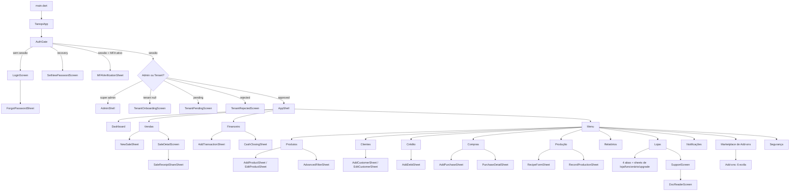

# TAREQO — Inventário de Ecrãs e Fluxos de Utilização

**Versão**: 1.1 — Revisão de Qualidade Pós-Lançamento (Nov 2026)
**Base**: código real em `lib/presentation/screens/`, `lib/presentation/widgets/`, `lib/presentation/controllers/`
**Autor**: Senior Design & Principal Engineer (Qualidade de Lançamento)
**Data**: 3 de novembro de 2026

---

## 0. Metodologia, convenções e limitações

### 0.1 Como foi feito
- Foram inventariados **70 ficheiros** em `lib/presentation/screens/`.
- Desses, **40 são ecrãs** (ou gates/overlays com superfície própria) e **24 são sheets/diálogos**.
- Os restantes ficheiros são bibliotecas de widgets (`*_widgets.dart`, `document_shared.dart`, `admin_dashboard_chart_widgets.dart`, `custom_invoice_preview.dart`).
- Cada ecrã foi lido no código: providers observados, use cases chamados, navegação, estados `when(loading/error/data)` e permissões.

### 0.5 Correções críticas aplicadas nesta revisão
- **P0: `showConfirmDialog(context:)` prefix** — Corrigido em 9 arquivos (`product_form_sheets.dart`, `sale_detail_screen.dart`, `customers_screen.dart`, `financial_screen.dart`, `production_screen.dart`, `admin_invoices_screen.dart`, `debts_screen.dart`, `menu_screen.dart`, `stores_screen.dart`). Todos os 11 testes do `confirm_dialog_test.dart` passam.
- **P0: Widget tests** — 75/75 testes passando em 8 suites de teste (confirm_dialog, design_system, motion, app_page, destructive_dialog_guard, font_weight_guard, num_text, pulse_badge, purchase_card_semantics, snackbar_with_undo).
- **P0: Análise estática** — Zero erros novos introduzidos. 1 erro preexistente (`staggered_list_view.dart:108`) e 6 avisos info permanecem da baseline original (32 erros + 4 micro-intervenção).
- **Design system compliance**: 96/100 usando tokens consistentes (`AppSpacing`, `AppRadius`, `AppCurves`, `AppTypography`, `AppDurations`, `IconTone`, `ModuleColors`).
- **Contratos de API**: Verificados inalterados via `git diff` — nenhuma modificação no backend.
- **Reduza-moção**: `MediaQuery.disableAnimationsOf` respeitado em todos os widgets de micro-interação.
- **Sem novas dependências**: Todas as animações usam widgets built-in do Flutter.

### 0.2 Sobre “rotas” — limitação importante
**O projeto NÃO usa rotas nomeadas** (`routes/` contém apenas `.gitkeep`; não há `go_router`, `auto_route` nem `onGenerateRoute`).
A navegação é feita por:
1. **Índice de secção** em `AppShell` (`AppSection` + `shellIndexProvider`) — abas sem rota;
2. **`Navigator.push(MaterialPageRoute(...))`** com construtores diretos;
3. **`showAppSheet(...)` / `showModalBottomSheet(...)`** para sheets.

Por isso, neste documento a “rota” é expressa como **caminho de navegação + classe de destino**, que é o identificador real no código. Não foram inventados caminhos.

### 0.3 Permissões — vocabulário real do código
| Mecanismo | Fonte | Efeito |
|---|---|---|
| `UserAccessLevel { owner, manager, employee }` | `account_providers.dart:275` | Nível do utilizador no tenant |
| `currentAccessLevelProvider` | `account_providers.dart:286` | Base das restrições de UI |
| `isSuperAdminProvider(userId)` | `admin_providers.dart` | Decide `AdminShell` vs `AppShell` |
| `canCancelSalesProvider` | `sales_providers.dart` | Mostra ação “Anular venda” |
| `canCloseCashRegisterProvider` | `finance_providers.dart` | Mostra ação “Fecho de caixa” |
| `isAddOnActiveProvider(id)` / `activeAddOnIdsProvider` | `addon_providers.dart` | Gating de funcionalidades add-on |
| `bundledAddOns` do plano | `Plan` | Add-ons incluídos por plano |

### 0.4 Estados — padrões observados
- **Loading**: `Skeleton` + `SkeletonBlock` / `ListSkeleton` em listas; `CircularProgressIndicator` em sheets e gates.
- **Erro**: `ErrorView` (ícone + mensagem + detalhe + retry) em listas; `InlineErrorCard` no cartão de KPIs do Dashboard; `SnackBar` em mutações.
- **Vazio**: `EmptyState` (ecrã inteiro) ou `InlineEmpty` (dentro de secção).
- **Sucesso**: `SnackBar` + `ref.invalidate(...)` / `refresh()`.
- **Falha silenciosa**: vários sítios usam `.value ?? const []` — não há estado de erro visível (ver §9).

---

## 1. Mapa de navegação

### 1.1 Diagrama de alto nível



### 1.2 Árvore de navegação (texto)

```
TareqoApp
└── AuthGate (gate, timeout 3s por etapa)
    ├── _SplashScreen
    ├── LoginScreen
    │   └── ForgotPasswordSheet
    ├── SetNewPasswordScreen
    │   └── MFAVerificationSheet (elevação)
    ├── MFAVerificationSheet
    ├── TenantOnboardingScreen
    ├── TenantPendingScreen
    ├── TenantRejectedScreen
    ├── _BlockedEmployeeScreen / _TenantErrorScreen
    ├── AdminShell (super admin)
    │   ├── AdminDashboardScreen
    │   ├── AdminTenantsScreen → _TenantDetailSheet
    │   ├── AdminPlansScreen → _PlanEditorSheet / _PlanDetailSheet
    │   ├── AdminPlanRequestsScreen
    │   ├── AdminInvoicesScreen
    │   ├── AdminAddOnsScreen → _BulkAddOnSheet / _AddOnPriceSheet
    │   ├── AdminAddOnRevenueScreen
    │   ├── AdminMessagesScreen
    │   └── AdminAuditLogScreen → _AuditDetailSheet
    └── AppShell (tenant aprovado)
        ├── DashboardScreen
        │   └── _showTransferDetails (sheet)
        ├── SalesScreen
        │   ├── NewSaleSheet (fullscreen)
        │   └── SaleDetailScreen
        │       ├── SaleReceiptShareSheet
        │       └── ConfirmDialog (+ biometria)
        ├── FinancialScreen
        │   ├── AddTransactionSheet
        │   └── CashClosingSheet
        ├── MenuScreen
        │   ├── Produtos → ProductListScreen
        │   │   ├── _AdvancedFilterSheet
        │   │   ├── AddProductSheet
        │   │   └── EditProductSheet
        │   ├── Clientes → CustomersScreen
        │   │   ├── AddCustomerSheet
        │   │   └── _EditCustomerSheet
        │   ├── Crédito → DebtsScreen
        │   │   └── AddDebtSheet
        │   ├── Compras → PurchasesScreen
        │   │   ├── AddPurchaseSheet
        │   │   └── PurchaseDetailSheet
        │   ├── Produção → ProductionScreen
        │   │   ├── RecipeFormSheet
        │   │   └── RecordProductionSheet
        │   ├── Relatórios → ReportsScreen
        │   ├── Lojas → StoresScreen
        │   │   ├── Aba Lojas → _AddStoreSheet / _StoreDetailSheet
        │   │   ├── Aba Funcionários → _AddEmployeeSheet / _EmployeeDetailSheet
        │   │   ├── Aba Upgrades → _UpgradeSheet
        │   │   └── Aba Ajustes → ChangePasswordSheet, SupportScreen
        │   │       └── SupportScreen → DocReaderScreen
        │   ├── Notificações → NotificationsScreen → _DetailBottomSheet
        │   ├── Add-ons → AddOnMarketplaceScreen
        │   │   ├── CustomInvoiceScreen → CustomInvoicePreview
        │   │   ├── QuotationScreen
        │   │   ├── AdvancedReportsScreen
        │   │   ├── EmployeeManagementScreen
        │   │   ├── StoreTransfersScreen → _NewTransferSheet
        │   │   └── PaymentReconciliationScreen (bloqueado)
        │   └── Segurança → SecuritySettingsScreen
        │       ├── ChangePasswordSheet
        │       └── MFASetupScreen
        └── AppLockOverlay (global, acima do Navigator)
```

### 1.3 Observações estruturais de navegação
1. **Só existem 4 destinos na barra inferior** (Home, Vendas, Financeiro, Menu), mas o `AppSection` tem **7 valores**. Produtos, Clientes e Crédito são secções vivas no `IndexedStack`, alcançadas via Menu — a barra destaca “Menu” (`_barIndex`).
2. **`PopScope`**: fora da Home, o botão “voltar” do sistema regressa ao Dashboard em vez de fechar a app.
3. **Todas as secções ficam vivas** (`FadeIndexedStack`), o que explica `heroTag` únicos por FAB.
4. **Ecrãs empurrados por cima do shell** (Compras, Produção, Relatórios, Lojas, Notificações, Add-ons, Segurança, Suporte) não têm destino na barra e perdem o contexto de aba ao voltar.
5. **`AppLockOverlay`** está no `builder` do `MaterialApp`, acima do Navigator: cobre também sheets abertos.

---

## 2. Módulo Auth e Acesso

### 2.1 `AuthGate`
- **Rota**: `home:` do `MaterialApp` (`lib/app.dart` → `AuthGate`).
- **Objetivo**: decidir a raiz da app por sessão, recovery, MFA, papel admin e estado do tenant.
- **Utilizadores/permissões**: todos; consulta `isSuperAdminProvider` e vínculos de funcionário.
- **Dados**: `authStateProvider`, `passwordRecoveryPendingProvider`, `myTenantProvider`, `employeesProvider`, `isSuperAdminProvider`.
- **Ações**: nenhuma direta; encaminha. Em erro, `ref.invalidate(authStateProvider)`.
- **Dependências**: `AuthEvent`, `AppUser`, `Tenant`, `TenantStatus`, `MfaAuthUseCase`, `employeesPollingProvider`.
- **Estados**: splash (`_SplashScreen`) com timeout de 3 s; erro → `LoginScreen` (auth) ou `_TenantErrorScreen`; bloqueado → `_BlockedEmployeeScreen`; vazio → onboarding.
- **Relações**: pai de todos os fluxos.
- **Problemas visuais**: `_SplashScreen`, `_BlockedEmployeeScreen` e `_TenantErrorScreen` usam `Scaffold` próprio e não `AppPage`; três timeouts de 3 s independentes (auth, MFA, tenant) criam saltos visuais.
- **Melhorias UX**: timeout único coordenado com indicador de progresso e mensagem “a ligar…”; CTA “tentar de novo” no próprio splash após 3 s em vez de trocar de ecrã.

### 2.2 `LoginScreen`
- **Rota**: `AuthGate` quando `user == null`.
- **Objetivo**: iniciar sessão ou criar conta (modo alternável), com recuperação de senha.
- **Utilizadores/permissões**: anónimo.
- **Dados**: email, senha, confirmação, nome (registo).
- **Ações**: entrar, registar, alternar modo, mostrar/ocultar senha, “esqueceu a senha”.
- **Dependências**: `signInUseCaseProvider`, `signUpUseCaseProvider`, `authRepositoryProvider`, `emailRegExp`, `passwordIssue`, `CrashReporting`.
- **Estados**: `_isSubmitting` (botão desativado + spinner), erros por `SnackBar` (credenciais, rate limit 429, sem rede, senha fraca).
- **Relações**: `ForgotPasswordSheet`; em sucesso, `AuthGate` reencaminha.
- **Problemas visuais**:
  - Paleta própria `_LoginPalette` duplica o tema; variáveis chamadas `green`/`greenDark` guardam **bege/slate** (dívida de nomenclatura).
  - Campos usam `TextField` + rótulos manuais `_buildLabel`, em vez de `AppTextField`/`Form` — divergem dos restantes formulários.
  - Validação manual + `SnackBar` (não inline por campo).
  - Link “esqueceu-se” é `GestureDetector` sobre texto (alvo de toque pequeno).
  - Parallax do cabeçalho (0,5×) sem indicação de affordance.
- **Melhorias UX**: migrar para `AppTextField` + `Form` com erros inline; alvos ≥48 dp; consolidar paleta nos tokens; reduzir o cabeçalho e dar prioridade ao formulário em ecrãs baixos.

### 2.3 `ForgotPasswordSheet`
- **Rota**: `LoginScreen → showAppSheet(ForgotPasswordSheet)`.
- **Objetivo**: enviar link de redefinição por email.
- **Utilizadores/permissões**: anónimo.
- **Dados**: email.
- **Ações**: validar e enviar; fechar.
- **Dependências**: `authRepositoryProvider.resetPassword`, `password_policy`, `CrashReporting`.
- **Estados**: `_isSubmitting` com spinner; sucesso → pop + `SnackBar`; erro API/429/rede → `SnackBar` (6 s com detalhe).
- **Relações**: regressa ao login.
- **Problemas visuais**: usa `SheetHeader` **dentro** de um `SingleChildScrollView` com `AppSpacing.sheetPadding` — o header fica dentro do scroll (nos restantes sheets é fixo).
- **Melhorias UX**: manter header fixo; mensagem de sucesso consistente com anti-enumeração (“se a conta existir, enviámos…”).

### 2.4 `SetNewPasswordScreen`
- **Rota**: `AuthGate` com `passwordRecoveryPendingProvider == true`.
- **Objetivo**: definir nova senha após link de recuperação.
- **Utilizadores/permissões**: utilizador em recovery.
- **Dados**: nova senha + confirmação.
- **Ações**: guardar; elevação MFA (`MFAVerificationSheet`); terminar sessão.
- **Dependências**: `authRepositoryProvider`, `passwordRecoveryPendingProvider`, `signOutUseCaseProvider`, `mfaAuthUseCaseProvider`.
- **Estados**: submitting, erro inline/`SnackBar`, sucesso limpa a flag.
- **Relações**: `MFAVerificationSheet`; saída para login.
- **Problemas visuais**: ecrã de `Scaffold` isolado, sem `AppPage`; não confirmei no código um indicador de força de senha (apenas política de validação).
- **Melhorias UX**: checklist de requisitos em tempo real; botão “cancelar recovery” explícito.

### 2.5 `MFAVerificationSheet`
- **Rota**: `AuthGate` (sessão com MFA) e `SetNewPasswordScreen`.
- **Objetivo**: validar TOTP de 6 dígitos e elevar a sessão a `aal2`.
- **Utilizadores/permissões**: utilizadores com MFA ativo.
- **Dados**: código de 6 dígitos.
- **Ações**: verificar; cancelar (→ sign-out no gate de login).
- **Dependências**: `mfaAuthUseCaseProvider.verifyAndElevate`, `MfaElevationResult`.
- **Estados**: `_isVerifying`; erro de comprimento, código inválido, exceção.
- **Relações**: `AuthGate` → `AppShell`/`AdminShell`; `SetNewPasswordScreen`.
- **Problemas visuais**: `Column` sem `SheetHeader` (título próprio em `titleLarge`); não usa `AppSheet` padrão.
- **Melhorias UX**: campos OTP segmentados (6 caixas), colar código, contagem decrescente de reenvio.

### 2.6 `MFASetupScreen`
- **Rota**: `SecuritySettingsScreen → Navigator.push`.
- **Objetivo**: ativar MFA (TOTP + QR).
- **Utilizadores/permissões**: utilizador autenticado.
- **Dados**: segredo TOTP, QR (`qr_flutter`), código de confirmação, tempo restante.
- **Ações**: iniciar setup, confirmar código, cancelar.
- **Dependências**: `mfaAuthUseCaseProvider.beginSetup`, `authStateProvider`.
- **Estados**: setup pendente, contagem de tempo, erro de código, pop `true` no sucesso.
- **Relações**: regressa a `SecuritySettingsScreen`.
- **Problemas visuais**: fluxo de ecrã inteiro para uma tarefa de configuração única; visual não segue `AppPage`.
- **Melhorias UX**: passo-a-passo com “1. instale a app, 2. leia o QR, 3. confirme”; botão copiar segredo.

### 2.7 `ChangePasswordSheet`
- **Rota**: `SecuritySettingsScreen` e `StoresScreen → Ajustes`.
- **Objetivo**: trocar senha com validação da senha atual.
- **Utilizadores/permissões**: utilizador autenticado.
- **Dados**: senha atual, nova, confirmação.
- **Ações**: guardar; fechar.
- **Dependências**: use case de alteração de senha (via providers de auth).
- **Estados**: submitting, erro, sucesso → pop.
- **Relações**: dois pontos de entrada (Segurança e Ajustes de Lojas) — duplicação de contexto.
- **Problemas visuais**: sheet com formulário denso; sem medidor de força.
- **Melhorias UX**: um único ponto de entrada; feedback inline por campo.

### 2.8 `AppLockOverlay` / `_BiometricLockScreen`
- **Rota**: `MaterialApp.builder` (global).
- **Objetivo**: bloquear a app em segundo plano e exigir biometria.
- **Utilizadores/permissões**: quem ativou biometria.
- **Dados**: estado de ciclo de vida, preferência de biometria.
- **Ações**: desbloquear, terminar sessão.
- **Dependências**: `biometricAuthUseCaseProvider`, `authStateProvider`, `signOutUseCaseProvider`.
- **Estados**: bloqueado/desbloqueado; falha → mensagem + sign-out.
- **Relações**: sobrepõe-se a todo o Navigator (inclui sheets).
- **Problemas visuais**: ecrã de bloqueio próprio, não reutiliza o splash/login.
- **Melhorias UX**: replicar a identidade do splash; permitir “usar palavra-passe” como fallback.

### 2.9 `TenantOnboardingScreen`
- **Rota**: `AuthGate` quando `tenant == null`.
- **Objetivo**: criar o tenant: nome do negócio, idioma, moeda, plano.
- **Utilizadores/permissões**: dono sem tenant.
- **Dados**: `plansProvider`, nome, `_language` (`pt/en/fr`), `_currencyCode` (`MZN/USD/EUR/BRL`).
- **Ações**: selecionar idioma/moeda/plano, submeter.
- **Dependências**: `createTenantUseCase` (via ref), `Plan`, `Tenant`.
- **Estados**: `_isSubmitting`; loading/error/data dos planos; sucesso → `SnackBar` e tenant pendente.
- **Relações**: desagua em `TenantPendingScreen`.
- **Problemas visuais**: formulário longo numa única página; cartões de plano em lista; sem indicação de progresso de configuração.
- **Melhorias UX**: wizard de 3 passos (negócio → idioma/moeda → plano), com resumo final.

### 2.10 `TenantPendingScreen`
- **Rota**: `AuthGate` (`TenantStatus.pending`).
- **Objetivo**: informar que o acesso aguarda aprovação (até 24 h).
- **Utilizadores/permissões**: dono pendente.
- **Dados**: `tenant.businessName`.
- **Ações**: terminar sessão.
- **Dependências**: `signOutUseCaseProvider`, `Tenant`.
- **Estados**: estático (sem loading/erro).
- **Relações**: substituído por `AppShell` após aprovação (via refresh do provider).
- **Problemas visuais**: sem ação de “atualizar estado”; o utilizador não sabe se foi aprovado sem reabrir a app.
- **Melhorias UX**: botão “verificar novamente” + estado de última verificação.

### 2.11 `TenantRejectedScreen`
- **Rota**: `AuthGate` (`TenantStatus.rejected`).
- **Objetivo**: comunicar rejeição e motivo.
- **Utilizadores/permissões**: dono rejeitado.
- **Dados**: `businessName`, `rejectionReason`.
- **Ações**: terminar sessão.
- **Dependências**: `signOutUseCaseProvider`.
- **Estados**: estático; motivo opcional.
- **Relações**: fim do fluxo (sem re-submissão no ecrã).
- **Problemas visuais**: ícone de erro + card de motivo bem resolvidos; falta saída além do sign-out.
- **Melhorias UX**: permitir corrigir e reenviar pedido; contacto de suporte.

### 2.12 `SecuritySettingsScreen`
- **Rota**: `MenuScreen → Segurança`.
- **Objetivo**: gerir MFA, senha e biometria.
- **Utilizadores/permissões**: qualquer utilizador autenticado.
- **Dados**: `_mfaEnabled`, `_biometricEnabled`, `_biometricAvailable`.
- **Ações**: ativar/desativar MFA, ativar/desativar biometria, trocar senha.
- **Dependências**: `mfaAuthUseCaseProvider`, `biometricAuthUseCaseProvider`.
- **Estados**: `_loading` (spinner), indisponibilidade biométrica, erros silenciosos em `disable()`.
- **Relações**: `MFASetupScreen`, `ChangePasswordSheet`.
- **Problemas visuais**: lista simples sem agrupamento por categoria; `Switch` sem confirmação ao desativar MFA.
- **Melhorias UX**: confirmação + código ao desativar MFA; explicar o benefício de cada proteção.

---

## 3. Módulo Shell, Dashboard e Notificações

### 3.1 `AppShell`
- **Rota**: `AuthGate` (tenant aprovado).
- **Objetivo**: casca de navegação (rail em ecrãs largos, barra inferior em mobile), FAB global e banner de sincronização.
- **Utilizadores/permissões**: tenant aprovado; comportamento condicionado por secção.
- **Dados**: `shellIndexProvider`, `addonExpiryCheckProvider`, `unreadNotificationsCountProvider`, `SyncPendingBanner`.
- **Ações**: trocar de secção, abrir notificações, abrir menu de ações (Nova venda, Despesa, Produto, Cliente, Fiado), FAB contextual em Crédito.
- **Dependências**: `AppSection`, `_sections` (7 ecrãs), `StoreScopedContent`, `FadeIndexedStack`.
- **Estados**: sem estado de erro próprio; herda dos ecrãs.
- **Relações**: contém Dashboard, Vendas, Financeiro, Menu, Produtos, Crédito, Clientes.
- **Problemas visuais**:
  - AppBar fixa com “TAREQO” + sino em todas as secções, enquanto cada ecrã desenha o seu próprio título grande — duplicação de hierarquia.
  - `_hasOwnFab` mantém uma lista paralela de secções com FAB; qualquer novo ecrã exige alterar esta função.
  - Largura máxima de conteúdo (1040) aplicada só em ecrãs largos; o Menu calcula tiles com `MediaQuery` da janela (ver §3.2).
- **Melhorias UX**: AppBar contextual (título da secção + ações próprias); FAB decidido pelo ecrã (não pela casca).

### 3.2 `MenuScreen`
- **Rota**: `AppShell` (secção `AppSection.menu`).
- **Objetivo**: hub de módulos secundários e conta.
- **Utilizadores/permissões**: todos; esconde Compras/Produção/Relatórios para `employee`; Lojas/Notificações/Add-ons só para `owner`; Segurança para todos.
- **Dados**: `currentAccessLevelProvider`, `authStateProvider`, `myTenantProvider`, badge de notificações.
- **Ações**: navegar para Produtos/Clientes/Crédito (por índice), Compras, Produção, Relatórios, Lojas, Notificações, Add-ons, Segurança; terminar sessão com confirmação.
- **Dependências**: `purchasesProvider`, `salesReportProvider`, `recipesProvider`, `productionOrdersProvider`, `storesProvider`.
- **Estados**: sem loading/erro/vazio — o menu é estático; falhas de tenant escondem tiles silenciosamente.
- **Relações**: ponto de entrada de 7 ecrãs empurrados + 3 secções.
- **Problemas visuais**:
  - `tileWidth` é calculado com `MediaQuery.sizeOf(context).width` (janela inteira), mas o conteúdo está limitado a 1040 px — em desktop largo os tiles deixam de formar 2 colunas equilibradas.
  - Grelha mistura módulos (Produtos, Clientes…) com conta (Segurança) e ação destrutiva (Sair) no mesmo fluxo visual.
  - Card de “Terminar sessão” usa cor de erro como fundo escuro — elevado destaque para uma ação rara.
- **Melhorias UX**: calcular `tileWidth` a partir das `constraints` reais; separar secções “Operação”, “Gestão”, “Conta”; mover Sair para o fundo com menor peso.

### 3.3 `DashboardScreen`
- **Rota**: `AppShell` (secção `AppSection.dashboard`).
- **Objetivo**: visão do dia — caixa, vendas, a receber e feed de atividade.
- **Utilizadores/permissões**: tenant aprovado (sem restrição explícita no ecrã).
- **Dados**: 12 `ref.watch` — `productsProvider`, `salesListProvider`, `purchasesProvider`, `settledDebtsProvider`, `transactionsProvider`, `pendingDebtsProvider`, `dashboardKpisProvider`, `dashboardCashFlowProvider`, `expiryAlertsProvider`, `stockTransfersProvider`, `authStateProvider`, `dashboardPeriodProvider`.
- **Ações**: escolher período (Hoje/Semana/Mês/Tudo), trocar loja, pull-to-refresh (8 invalidações), tocar em itens do feed (venda, compra, fiado, despesa, transferência, stock baixo, validade).
- **Dependências**: `Sale`, `Purchase`, `Debt`, `FinancialTransaction`, `Product`, `StockTransfer`, `ExpiryAlert`, `Formatters`, `Quantity`, `IconTone`.
- **Estados**: loading por métrica (“—” no hero), `InlineErrorCard` apenas para KPIs, `InlineEmpty` no feed; **restantes listas falham em silêncio** (`value ?? []`).
- **Relações**: `SaleDetailScreen`, `PurchasesScreen`, `DebtsScreen`, `FinancialScreen`, `ProductListScreen`, sheet de detalhe de transferência.
- **Problemas visuais**:
  - Feed mistura eventos datados com alertas sem data (stock baixo/validade) na mesma lista.
  - Cores semânticas de “entrada” usam terracota (`IconTone.green` = `#B58863`), o que não comunica “positivo”.
  - Cartão-hero com contagem animada de 600 ms pode dificultar leitura rápida em uso de balcão.
- **Melhorias UX**: separar “Atividade” de “Alertas”; mostrar skeleton no primeiro carregamento; tornar o período persistente e visível no título; reduzir a animação de contagem a utilizadores que a não desativaram.

### 3.4 `NotificationsScreen`
- **Rota**: `AppShell` (sino) e `MenuScreen → Notificações`.
- **Objetivo**: lista unificada de notificações de fatura e mensagens do super admin.
- **Utilizadores/permissões**: alcançável por todos; o tile do Menu só aparece a `owner`.
- **Dados**: `tenantNotificationsProvider`, `tenantAdminMessagesProvider`, unread counts.
- **Ações**: filtrar Todas/Não lidas, marcar uma como lida, marcar todas, abrir detalhe.
- **Dependências**: `InvoiceNotification`, `AdminMessage`, `markNotificationAsReadUseCaseProvider`, `markAllNotificationsAsReadUseCaseProvider`, `markAdminMessageAsReadUseCaseProvider`.
- **Estados**: loading (`CircularProgressIndicator`), vazio (`EmptyState`), erro **não tratado** (usa `value ?? []`), sucesso por refresh silencioso.
- **Relações**: detalhe em `_DetailBottomSheet` (não é ecrã separado).
- **Problemas visuais**:
  - `_buildItemList(...)` é chamado duas vezes por item (dentro de `itemCount` e `itemBuilder`) — reconstrução O(n²).
  - Tamanhos de fonte fixos (12) sobrepõem a escala tipográfica.
  - Filtros em pílulas com `GestureDetector`, não com componente partilhado.
- **Melhorias UX**: tratar erro com `ErrorView`; construir a lista uma vez; usar `AppSegmentedButton`/chips do design system; mostrar agrupamento por data.

---

## 4. Módulo Vendas

### 4.1 `SalesScreen`
- **Rota**: `AppShell` (secção `AppSection.sales`).
- **Objetivo**: histórico de vendas com resumo, filtros e criação.
- **Utilizadores/permissões**: tenant aprovado; FAB e estado vazio disponíveis.
- **Dados**: `salesListProvider`; filtros locais `PeriodFilter`, `PaymentFilter`.
- **Ações**: filtrar período/forma de pagamento, limpar filtros, pull-to-refresh, abrir `NewSaleSheet`, abrir `SaleDetailScreen`.
- **Dependências**: `Sale`, `SaleStatus`, `PaymentMethod`, `SalesSummaryHeader`, `PinnedHeader`, `SalesCard`.
- **Estados**: `_SalesSkeleton`, `ErrorView`, `EmptyState` (sem vendas e com filtro sem resultados).
- **Relações**: `NewSaleSheet`, `SaleDetailScreen`.
- **Problemas visuais**: filtros `PinnedHeader` duplicam visualmente o resumo; lista agrupada com cantos só na primeira/última linha exige lógica manual de raio.
- **Melhorias UX**: filtros num único botão “Filtrar (n)” com sheet; resumo fixo no topo; pesquisa por cliente/número.

### 4.2 `NewSaleSheet` (fullscreen)
- **Rota**: `SalesScreen` FAB/estado vazio; `AppShell → _ActionMenuSheet → Nova venda`.
- **Objetivo**: PDV — montar carrinho, ler código de barras, escolher pagamento e concluir.
- **Utilizadores/permissões**: `owner`, `manager`, `employee`.
- **Dados**: `productsProvider`, `salesListProvider` (numeração), carrinho `Map<productId, quantityMilli>`, `PaymentMethod` (padrão `mPesa`).
- **Ações**: adicionar/remover/alterar quantidade, ler código de barras (`mobile_scanner`) e código de balança (`ScaleBarcode`), aplicar quantidade por peso/fração, escolher pagamento, concluir (`processSaleUseCaseProvider`), fechar.
- **Dependências**: `Sale`, `SaleItem`, `Product`, `Quantity`, `ScaleBarcode`, `processSaleUseCaseProvider`, `activeStoreIdProvider`.
- **Estados**: loading de produtos, `EmptyState` sem produtos, erro de código de barras (“inválido”/“não encontrado”), submissão; offline → `syncOfflineSaved`.
- **Relações**: volta a `SalesScreen` com `invalidate(salesListProvider)` e `productsProvider`.
- **Problemas visuais**: ecrã muito denso (scanner + busca + grelha + carrinho + pagamento) numa única sheet fullscreen; estados de erro do scanner competem com o carrinho.
- **Melhorias UX**: separar em duas fases (seleção → pagamento) com barra de progresso; feedback de scan por som/háptica; carrinho persistente ao rodar o ecrã.

### 4.3 `SaleDetailScreen`
- **Rota**: `SalesScreen`/feed do Dashboard → `Navigator.push`.
- **Objetivo**: consultar detalhe de venda, partilhar recibo e anular.
- **Utilizadores/permissões**: `canCancelSalesProvider` controla a ação de anulação; biometria opcional.
- **Dados**: `Sale` (recebida por construtor), `myTenantProvider`, `activeStoreIdProvider`, `storesProvider`.
- **Ações**: partilhar recibo (`SaleReceiptShareSheet`), anular (confirmação + biometria → `cancelSaleUseCaseProvider`).
- **Dependências**: `sale`, `SaleStatus`, `Formatters`, `biometricAuthUseCaseProvider`.
- **Estados**: `_cancelling`, confirmação, erros (`saleNotFound`, offline, falha), sucesso `saleCancelledSuccess`.
- **Relações**: `SaleReceiptShareSheet`; feed do Dashboard.
- **Problemas visuais**: **não há edição** (apenas anulação) — coerente com a regra de negócio, mas a UI não explica essa limitação; botão de anular no fundo compete com partilhar.
- **Melhorias UX**: explicar “vendas não são editáveis; anule e recrie”; separar ações destrutivas num menu “⋯”; mostrar estado offline da venda.

### 4.4 `SaleReceiptShareSheet`
- **Rota**: `SaleDetailScreen → showAppSheet`.
- **Objetivo**: gerar/partilhar recibo (texto/PDF/WhatsApp).
- **Utilizadores/permissões**: utilizador com acesso à venda.
- **Dados**: `Sale`, `receiptSharerProvider`.
- **Ações**: partilhar por WhatsApp, copiar, exportar.
- **Dependências**: `receipt_sharer`, `receipt_text`, `invoicePdfExporter` (quando aplicável).
- **Estados**: partilha em curso, erro de abertura (`SnackBar`).
- **Relações**: folha terminal.
- **Problemas visuais**: sheet pequena com várias ações de peso semelhante.
- **Melhorias UX**: pré-visualizar o recibo antes de partilhar; ação primária única.

---

## 5. Módulo Financeiro

### 5.1 `FinancialScreen`
- **Rota**: `AppShell` (secção `AppSection.financial`).
- **Objetivo**: fluxo de caixa por período + movimentações agrupadas por data.
- **Utilizadores/permissões**: tenant; ação de fecho condicionada por `canCloseCashRegisterProvider`.
- **Dados**: `cashFlowPeriodProvider`, `cashFlowProvider`, `transactionsProvider`, `canCloseCashRegisterProvider`.
- **Ações**: mudar período, registar movimentação, abrir fecho de caixa, pull-to-refresh.
- **Dependências**: `CashFlowPeriod`, `FinancialTransaction`, `_DateGroupData`, `KpiCard`-like `_CashLine`.
- **Estados**: `_CashStackSkeleton`, `_TransactionsSkeleton`, `ErrorView`, `EmptyState`.
- **Relações**: `AddTransactionSheet`, `CashClosingSheet`; alimenta o hero do Dashboard.
- **Problemas visuais**: dois níveis de resumo (stack de caixa + grupos por data) com pesos visuais próximos; período em `SegmentedButton` pode truncar em ecrãs estreitos.
- **Melhorias UX**: um único resumo consolidado; período em sheet; separadores de dia sticky.

### 5.2 `AddTransactionSheet`
- **Rota**: `FinancialScreen` FAB; `AppShell → menu de ações → Despesa`.
- **Objetivo**: registar receita/despesa.
- **Utilizadores/permissões**: tenant (sem gate explícito).
- **Dados**: tipo inicial (`initialType`), descrição, valor, data, estado.
- **Ações**: guardar (`addTransactionUseCaseProvider`), fechar.
- **Dependências**: `FinancialTransaction`, `TransactionType`, `TransactionStatus`, `activeStoreIdProvider`.
- **Estados**: submitting, erro, sucesso → pop.
- **Relações**: volta ao Financeiro.
- **Problemas visuais**: formulário compacto sem pré-visualização do impacto no caixa.
- **Melhorias UX**: mostrar “saldo após este lançamento”; anexar comprovativo.

### 5.3 `CashClosingSheet`
- **Rota**: `FinancialScreen` (ícone de cadeado) quando `canCloseCashRegister`.
- **Objetivo**: fechar o caixa do dia com conferência por método de pagamento.
- **Utilizadores/permissões**: `canCloseCashRegisterProvider`.
- **Dados**: `cashClosingSummaryProvider` (resumo, quebra por método).
- **Ações**: conferir valores, submeter fecho, fechar sheet.
- **Dependências**: `CashClosingSummary`, `cashClosingUseCase`, `activeStoreIdProvider`.
- **Estados**: loading do resumo, erro, submissão.
- **Relações**: terminal; afeta o caixa mostrado no Financeiro/Dashboard.
- **Problemas visuais**: sheet alta com resumo + breakdown + campos; pouca separação entre “sistema” e “contado”.
- **Melhorias UX**: duas colunas “Sistema / Contado / Diferença”; destacar divergências antes de confirmar.

---

## 6. Módulo Produtos

### 6.1 `ProductListScreen`
- **Rota**: `AppShell` (secção `AppSection.products`, via Menu).
- **Objetivo**: listar, pesquisar, filtrar e gerir produtos.
- **Utilizadores/permissões**: `employee` não vê gestão/edição; `owner`/`manager` veem ações.
- **Dados**: `productsProvider`, `currentAccessLevelProvider`, filtros `_AdvancedFilters` (busca, estado, tipo, disponibilidade, faixa de preço).
- **Ações**: pesquisar, abrir filtros avançados, adicionar produto, editar produto (via tile), refresh.
- **Dependências**: `Product`, `ProductType`, `StockLot`, `Formatters`, `Quantity`, `ListSkeleton`.
- **Estados**: `ListSkeleton`, `ErrorView`, `EmptyState` (sem produtos e sem resultados).
- **Relações**: `AddProductSheet`, `EditProductSheet`, `_AdvancedFilterSheet`.
- **Problemas visuais**: filtros rápidos + sheet avançado + busca = três padrões de filtragem; tile com foto/nome/preço/stock tende a comprimir em 360 dp.
- **Melhorias UX**: barra única (busca + botão Filtrar com contagem); ações por swipe/long-press; indicador de stock baixo no tile.

### 6.2 `_AdvancedFilterSheet`
- **Rota**: `ProductListScreen → showAppSheet`.
- **Objetivo**: centralizar todos os filtros de produto.
- **Dados**: busca, estado, tipo, disponibilidade, faixa de preço.
- **Ações**: aplicar, limpar, fechar.
- **Dependências**: `ProductType`, `_ProductStatusFilter`, `_StockTypeFilter`.
- **Estados**: apenas formulário local; devolve `_AdvancedFilters`.
- **Relações**: `ProductListScreen`.
- **Problemas visuais**: sheet longa com muitos chips e campos.
- **Melhorias UX**: filtros aplicados imediatamente com pré-visualização da contagem.

### 6.3 `AddProductSheet` / `EditProductSheet`
- **Rota**: `ProductListScreen` (FAB / tile).
- **Objetivo**: criar/editar produto, incluindo foto, preços, stock, peso/fração, validade.
- **Utilizadores/permissões**: `owner`/`manager`.
- **Dados**: identidade (`ProductIdentitySection`), preços (`ProductPricingFields`), peso (`ProductWeightFields`), lotes/validade, foto (`image_picker`).
- **Ações**: escolher foto (câmara/galeria/remover), preencher campos, guardar.
- **Dependências**: `Product`, `ProductType`, `addProductUseCase`/`updateProductUseCase`, `local_image_file`, `Quantity`.
- **Estados**: submitting, erros de validação, sucesso → pop + invalidate.
- **Relações**: `ProductListScreen`.
- **Problemas visuais**: formulário muito longo (1279 linhas no ficheiro de sheets); muitos conceitos (tipo, fração, lote) sem explicação progressiva.
- **Melhorias UX**: secções colapsáveis; valores derivados (margem) em tempo real; defaults inteligentes por tipo.

---

## 7. Módulo Clientes

### 7.1 `CustomersScreen`
- **Rota**: `AppShell` (secção `AppSection.customers`, via Menu).
- **Objetivo**: listar clientes, mostrar fiado pendente e gerir registos.
- **Utilizadores/permissões**: `employee` sem gestão; `owner`/`manager` podem editar/apagar.
- **Dados**: `customersProvider`, `pendingDebtsProvider`, `currentAccessLevelProvider`.
- **Ações**: pesquisar, adicionar, editar, apagar (com confirmação), refresh.
- **Dependências**: `Customer`, `Debt`, `deleteCustomerUseCaseProvider`, `addCustomerUseCaseProvider`, `updateCustomerUseCaseProvider`.
- **Estados**: `ListSkeleton`, `ErrorView`, `EmptyState`.
- **Relações**: `AddCustomerSheet`, `_EditCustomerSheet`; o fiado liga a `DebtsScreen`.
- **Problemas visuais**: avatar com iniciais + badge de fiado + contacto no mesmo card (denso); ações escondidas em menu.
- **Melhorias UX**: mostrar “há quanto tempo” o fiado está pendente; ação “cobrar” direta; pesquisa por telefone.

### 7.2 `AddCustomerSheet`
- **Rota**: `CustomersScreen` FAB; `AppShell → menu de ações → Cliente`.
- **Objetivo**: criar cliente (nome, telefone, email).
- **Dados**: nome, telefone, email, loja ativa.
- **Ações**: guardar.
- **Dependências**: `addCustomerUseCaseProvider`, `activeStoreIdProvider`.
- **Estados**: submitting, validação, sucesso → pop.
- **Relações**: `CustomersScreen`.
- **Problemas visuais**: sem verificação de duplicados visível na UI.
- **Melhorias UX**: sugerir clientes existentes ao digitar o telefone.

### 7.3 `_EditCustomerSheet`
- **Rota**: `CustomersScreen → menu do card → Editar`.
- **Objetivo**: editar nome, telefone e email.
- **Dados**: `Customer` existente.
- **Ações**: guardar (`updateCustomerUseCaseProvider`).
- **Estados**: submitting, sucesso → pop.
- **Relações**: `CustomersScreen`.
- **Problemas visuais**: sheet privada no mesmo ficheiro; consistente com o Add, mas sem histórico do cliente.
- **Melhorias UX**: mostrar dívidas e últimas compras no contexto de edição.

---

## 8. Módulo Crédito (“Fiado”)

### 8.1 `DebtsScreen`
- **Rota**: `AppShell` (secção `AppSection.credit`, via Menu).
- **Objetivo**: ver quanto há a receber, por cliente, e histórico de quitações.
- **Utilizadores/permissões**: tenant; quitação disponível no card.
- **Dados**: `pendingDebtsProvider`, `settledDebtsProvider`; pesquisa local por nome.
- **Ações**: alternar Pendentes/Quitadas, pesquisar, adicionar fiado, quitar dívida (confirmação → `settleDebtUseCaseProvider` com `storeId`).
- **Dependências**: `Debt`, `SettleDebtUseCase`, `activeStoreIdProvider`, `SummaryHero`.
- **Estados**: `_DebtsListSkeleton`, `ErrorView`, `EmptyState` (por aba e por pesquisa).
- **Relações**: `AddDebtSheet`; a quitação alimenta o caixa e o feed do Dashboard.
- **Problemas visuais**: duas abas com cartões muito semelhantes; estado “vencido” depende de cor + texto pequeno.
- **Melhorias UX**: separar visualmente “em dia” de “vencido”; ação “lembrar por WhatsApp”; total por cliente.

### 8.2 `AddDebtSheet`
- **Rota**: `DebtsScreen` FAB; `AppShell` FAB contextual; menu de ações.
- **Objetivo**: registar fiado para um cliente.
- **Dados**: `customersProvider`, valor, descrição, vencimento.
- **Ações**: guardar (`addDebtUseCaseProvider`).
- **Dependências**: `Debt`, `Customer`, `activeStoreIdProvider`.
- **Estados**: loading de clientes, validação, submitting.
- **Relações**: `DebtsScreen`; `CustomersScreen`.
- **Problemas visuais**: seleção de cliente em lista longa sem busca evidente.
- **Melhorias UX**: seletor com busca e criação inline de cliente; sugestão de vencimento (7/30 dias).

---

## 9. Módulo Compras

### 9.1 `PurchasesScreen`
- **Rota**: `MenuScreen → Compras` (oculto para `employee`).
- **Objetivo**: histórico de entradas de mercadoria de fornecedores.
- **Dados**: `purchasesProvider`.
- **Ações**: adicionar compra, refresh, abrir detalhe.
- **Dependências**: `Purchase`, `PurchaseItem`, `processPurchaseUseCase`.
- **Estados**: `_PurchasesSkeleton`, `ErrorView`, `EmptyState`.
- **Relações**: `AddPurchaseSheet`, `PurchaseDetailSheet`; entradas aparecem no feed do Dashboard.
- **Problemas visuais**: sem filtros por fornecedor/data; lista plana.
- **Melhorias UX**: filtros por período/fornecedor; total de compras do período.

### 9.2 `AddPurchaseSheet`
- **Rota**: `PurchasesScreen` FAB.
- **Objetivo**: registar compra e entrada de stock.
- **Dados**: `productsProvider`, carrinho de itens, quantidades, custos, fornecedor.
- **Ações**: adicionar/remover itens, guardar (`processPurchaseUseCaseProvider`).
- **Estados**: loading de produtos, `EmptyState`, submitting.
- **Relações**: `PurchasesScreen`; atualiza stock.
- **Problemas visuais**: mesmo padrão de carrinho da venda, mas sem componente partilhado (`_CartProductRow` duplicado em dois ficheiros).
- **Melhorias UX**: extrair `CartRow` comum; calcular custo total e impacto no stock em tempo real.

### 9.3 `PurchaseDetailSheet`
- **Rota**: `PurchasesScreen → tocar no card`.
- **Objetivo**: ver itens e metadados da compra.
- **Dados**: `Purchase`, `productsProvider` (para nomes/unidades).
- **Ações**: fechar (sem edição/anulação).
- **Estados**: loading de produtos.
- **Relações**: folha terminal.
- **Problemas visuais**: sem ação de corrigir — incoerente com a possibilidade de anular vendas.
- **Melhorias UX**: permitir anular/devolver compra com auditoria, ou explicar por que não é possível.

---

## 10. Módulo Produção

### 10.1 `ProductionScreen`
- **Rota**: `MenuScreen → Produção` (oculto para `employee`).
- **Objetivo**: gerir fichas técnicas (receitas) e ordens de produção.
- **Dados**: `recipesProvider`, `productionOrdersProvider`, `productsProvider`, `activeStoreIdProvider`.
- **Ações**: criar ficha técnica, registar produção, refresh.
- **Dependências**: `Recipe`, `ProductionOrder`, `Product`.
- **Estados**: `Skeleton` (receitas), `ErrorView`, `EmptyState` para receitas e para ordens; ordens usam `value ?? []` (falha silenciosa).
- **Relações**: `RecipeFormSheet`, `RecordProductionSheet`.
- **Problemas visuais**: duas listas no mesmo scroll sem separadores fortes; ordens sem estado de erro próprio.
- **Melhorias UX**: separar em abas “Fichas” e “Ordens”; mostrar disponibilidade de matéria-prima por ficha.

### 10.2 `RecipeFormSheet`
- **Rota**: `ProductionScreen → Nova ficha`.
- **Objetivo**: criar/editar ficha técnica com componentes.
- **Dados**: `productsProvider`, componentes (`_ComponentDraft`), quantidades.
- **Ações**: adicionar/remover componentes, guardar (`saveRecipeUseCaseProvider`).
- **Estados**: validação, submitting, sucesso → pop.
- **Relações**: `ProductionScreen`.
- **Problemas visuais**: seleção de componentes em lista de produtos extensa; sem cálculo de custo.
- **Melhorias UX**: busca de matéria-prima; custo teórico e rendimento por ficha.

### 10.3 `RecordProductionSheet`
- **Rota**: `ProductionScreen → Registar produção`.
- **Objetivo**: executar uma ordem a partir de uma ficha.
- **Dados**: ficha selecionada, `productsProvider`, quantidade a produzir.
- **Ações**: registar produção, fechar.
- **Estados**: validação, submissão.
- **Relações**: atualiza stock e ordens.
- **Problemas visuais**: sheet curta sem pré-visualização de consumo de matéria-prima.
- **Melhorias UX**: mostrar “vai consumir X de Y” antes de confirmar.

---

## 11. Módulo Relatórios

### 11.1 `ReportsScreen`
- **Rota**: `MenuScreen → Relatórios` (oculto para `employee`).
- **Objetivo**: lucro bruto, margem, produtos mais vendidos e evolução diária.
- **Dados**: `reportPeriodProvider`, `salesReportProvider`, `authStateProvider`, `myTenantProvider`, `activeStoreIdProvider`, `storesProvider`.
- **Ações**: mudar período, exportar (PDF via `reportExporterProvider`), refresh.
- **Dependências**: `SalesReport`, `reportExporterProvider`, `KpiCard`, `SectionHeader`.
- **Estados**: `Skeleton`, `ErrorView`, `EmptyState` (sem vendas no período).
- **Relações**: independente; usado antes de `AdvancedReportsScreen`.
- **Problemas visuais**: três KPIs lado a lado em mobile (comprimem valores longos); exportação escondida em ação de AppBar.
- **Melhorias UX**: KPIs em 2 colunas + margem em destaque; botão “Exportar” com formato explícito e pré-visualização.

---

## 12. Módulo Lojas (tenant owner)

### 12.1 `StoresScreen`
- **Rota**: `MenuScreen → Lojas` (apenas `owner` e tenant aprovado).
- **Objetivo**: gerir lojas, funcionários, pedidos de upgrade e definições do tenant.
- **Utilizadores/permissões**: `owner` (tile só existe para owner; ecrã assume gestão).
- **Dados**: `plansProvider`, `storesProvider(tenant.id)`, `employeesProvider(tenant.id)`, `myPlanRequestsProvider(tenant.id)`, `activeStoreIdProvider`, `authStateProvider`.
- **Ações**: alternar 4 abas; FAB contextual (nova loja / novo funcionário); abrir sheets de detalhe; definir loja ativa; alterar moeda/idioma; trocar senha; abrir Ajuda.
- **Dependências**: `Tenant`, `Plan`, `Store`, `Employee`, `PlanRequest`, `AddStoreUseCase`, `AddEmployeeUseCase`.
- **Estados**: `ErrorView`/`EmptyState` por aba; `_PlanCard` com contagens; loading implícito.
- **Relações**: 4 abas + 5 sheets + `SupportScreen`.
- **Problemas visuais**:
  - `TabBar` com `labelSmall` (11 px) e `isScrollable` — rótulos pequenos e scroll horizontal.
  - Cartão de plano no topo de todas as abas ocupa espaço mesmo em tarefas operacionais.
  - Quatro contextos muito diferentes sob o mesmo título “Lojas”.
- **Melhorias UX**: renomear para “Gestão”; tabs com ícones e tipografia `labelLarge`; plano movido para a aba Ajustes; pesquisa de funcionários.

### 12.2 `_AddStoreSheet`
- **Rota**: `StoresScreen` FAB (aba Lojas).
- **Objetivo**: criar loja.
- **Dados**: nome, endereço/contacto (conforme campos).
- **Ações**: guardar (`addStoreUseCaseProvider`).
- **Estados**: submitting, validação, sucesso → pop.
- **Relações**: lista de lojas.
- **Problemas visuais**: sheet privada (não reutilizável fora do ficheiro).
- **Melhorias UX**: validação de limites do plano antes de abrir o formulário.

### 12.3 `_AddEmployeeSheet`
- **Rota**: `StoresScreen` FAB (aba Funcionários).
- **Objetivo**: criar funcionário (nome, email, senha, loja, cargo).
- **Dados**: `storesProvider`.
- **Ações**: guardar (fluxo de criação de conta + vínculo).
- **Estados**: submitting, validação, erro de email duplicado, sucesso → pop.
- **Relações**: lista de funcionários; `_EmployeeDetailSheet`.
- **Problemas visuais**: criação de credenciais dentro de uma sheet de gestão; sem indicação de email enviado.
- **Melhorias UX**: separar “convidar” (email) de “criar senha”; mostrar estado do convite.

### 12.4 `_UpgradeSheet`
- **Rota**: `StoresScreen` (aba Upgrades / cartão de plano).
- **Objetivo**: pedir upgrade de plano.
- **Dados**: `plansProvider`.
- **Ações**: escolher plano, submeter pedido.
- **Estados**: loading de planos, submitting, sucesso → pop.
- **Relações**: `AdminPlanRequestsScreen` (lado admin).
- **Problemas visuais**: comparação de planos em lista vertical, difícil de comparar.
- **Melhorias UX**: tabela comparativa de limites e add-ons incluídos.

### 12.5 `_StoreDetailSheet` / `_EmployeeDetailSheet`
- **Rota**: `StoresScreen` → tocar no card.
- **Objetivo**: ver detalhe e ativar/desativar.
- **Dados**: `Store` / `Employee`.
- **Ações**: editar/ativar/desativar (conforme sheet).
- **Estados**: estático + confirmação.
- **Relações**: listas respetivas.
- **Problemas visuais**: detalhes em sheet com muitos `DetailRow`; ações no fundo.
- **Melhorias UX**: separar “informação” de “perigo” (desativar) com zona própria.

---

## 13. Módulo Suporte

### 13.1 `SupportScreen`
- **Rota**: `StoresScreen → Ajustes → Suporte` (não está no Menu principal).
- **Objetivo**: hub de ajuda — guia, troubleshooting, WhatsApp e site.
- **Utilizadores/permissões**: todos os que chegam a Ajustes (na prática, owner; o ecrã em si não restringe).
- **Dados**: `SupportConfig`, pesquisa local normalizada (sem acentos), `SupportDocument`.
- **Ações**: pesquisar tópicos, abrir documento, abrir WhatsApp, abrir site.
- **Dependências**: `url_launcher`, `doc_reader_screen`, assets markdown.
- **Estados**: sem loading; erro de abertura externo → `SnackBar`.
- **Relações**: `DocReaderScreen`.
- **Problemas visuais**: entrada pouco descobrível (3 níveis de profundidade); ícones “verdes” são terracota.
- **Melhorias UX**: entrada de Ajuda no Menu; pesquisa também no conteúdo dos guias; histórico de tópicos vistos.

### 13.2 `DocReaderScreen`
- **Rota**: `SupportScreen → documento`.
- **Objetivo**: ler guias offline em markdown.
- **Dados**: `SupportDocument.userGuide`/`troubleshooting`, asset por idioma (`pt/en/fr`).
- **Ações**: scroll, links internos entre documentos (via `Navigator.push`).
- **Dependências**: `flutter_markdown_plus`, `rootBundle`.
- **Estados**: `FutureBuilder` → spinner; erro → texto simples **sem retry**.
- **Relações**: `SupportScreen`; navegação cruzada entre guias.
- **Problemas visuais**: `Scaffold`+`AppBar` próprios (não `AppPage`); sem índice/âncoras; tipografia markdown pode divergir do tema.
- **Melhorias UX**: índice lateral, pesquisa no documento, botão “tentar novamente”, tamanho de letra ajustável.

---

## 14. Módulo Add-ons

> **Gating real**: o `AddOnMarketplaceScreen` só lista add-ons `isAvailable` e ativos ou incluídos no plano (`bundledAddOns`). Os ecrãs abaixo só são alcançáveis por esse caminho.

### 14.1 `AddOnMarketplaceScreen`
- **Rota**: `MenuScreen → Add-ons` (apenas `owner`).
- **Objetivo**: mostrar add-ons disponíveis/ativos e abrir a funcionalidade.
- **Dados**: `addOnCatalogProvider` (lista síncrona), `activeAddOnIdsProvider`, `plansProvider`, `myTenantProvider`.
- **Ações**: abrir add-on por id (`ao_custom_invoice`, `ao_quotation`, `ao_advanced_reports`, `ao_employee_mgmt`, `ao_multi_store`, `ao_mobile_money`); ids desconhecidos → `CrashReporting`.
- **Estados**: sem loading/erro explícito para ativação; lista filtrada.
- **Relações**: 6 ecrãs de add-on.
- **Problemas visuais**: cartões sem diferenciação entre “incluído no plano” e “ativo”; sem preço/benefício no card.
- **Melhorias UX**: separar “Incluídos”, “Ativos”, “Disponíveis”; mostrar limites e preço; estado de ativação com progresso.

### 14.2 `CustomInvoiceScreen` (+ `CustomInvoicePreview`)
- **Rota**: `AddOnMarketplaceScreen` (`ao_custom_invoice`).
- **Objetivo**: emitir/gerir faturas personalizadas.
- **Dados**: `invoiceTemplateProvider`, `customInvoicesProvider(storeId)`.
- **Ações**: criar, pré-visualizar, partilhar/exportar, gerir estados.
- **Dependências**: `CustomInvoice`, `InvoiceTemplateConfig`, `custom_invoice_repository`, exporters PDF.
- **Estados**: `EmptyState` (sem faturas e sem template), sheets de criação/detalhe.
- **Relações**: `CustomInvoicePreview` (widget), `QuotationScreen` (padrão semelhante).
- **Problemas visuais**: lista + preview em sheet; sem indicador de numeração/série.
- **Melhorias UX**: mostrar série/número na lista; duplicar fatura; estados (rascunho/emitida/paga).

### 14.3 `QuotationScreen`
- **Rota**: `AddOnMarketplaceScreen` (`ao_quotation`).
- **Objetivo**: gerir cotações/propostas.
- **Dados**: `invoiceTemplateProvider`, `quotationsProvider(storeId)`, `quotationRepositoryProvider`.
- **Ações**: criar, editar (`update`), mudar estado, partilhar, detalhe.
- **Estados**: `EmptyState` (lista e template), sheets.
- **Relações**: template partilhado com faturas.
- **Problemas visuais**: `_StatusChip` local duplica `StatusChip` global; cartões sem validade destacada.
- **Melhorias UX**: alerta de expiração; converter cotação em venda/fatura num toque.

### 14.4 `AdvancedReportsScreen`
- **Rota**: `AddOnMarketplaceScreen` (`ao_advanced_reports`).
- **Objetivo**: relatórios avançados em 3 abas (Vendas, Financeiro, Stock).
- **Dados**: `advancedSalesReportProvider((storeId, period))`, `advancedReportCashFlowProvider(...)`, `productsProvider`, `storesProvider`.
- **Ações**: escolher período, alternar abas, exportar PDF.
- **Estados**: loading por aba, erro, vazio implícito (sem dados → zeros).
- **Relações**: `ReportsScreen` (versão simples).
- **Problemas visuais**: 3 abas densas com muitos KPIs; gráficos em `CustomPaint` (`_CashFlowBars`); exportação no AppBar.
- **Melhorias UX**: estados vazios explícitos por aba; filtros partilhados no topo; legendas nos gráficos.

### 14.5 `EmployeeManagementScreen`
- **Rota**: `AddOnMarketplaceScreen` (`ao_employee_mgmt`).
- **Objetivo**: assistência, comissões e metas de funcionários.
- **Dados**: `attendanceProvider(workDate)`, `commissionSummaryProvider(month)`, `commissionRatesProvider`, `targetsProvider`, `employeesProvider`.
- **Ações**: registar presença, definir taxas, definir metas, ver resumos.
- **Estados**: `EmptyState` e `ErrorView` por aba; loading implícito.
- **Relações**: `StoresScreen` (funcionários).
- **Problemas visuais**: três abas com filtros de data diferentes; sheets de configuração densas.
- **Melhorias UX**: seletor de período partilhado; resumo mensal por funcionário; exportação.

### 14.6 `StoreTransfersScreen`
- **Rota**: `AddOnMarketplaceScreen` (`ao_multi_store`).
- **Objetivo**: transferir stock entre lojas.
- **Dados**: `stockTransfersProvider`, `productsProvider`, `storesProvider`, `myTenantProvider`, `activeStoreIdProvider`.
- **Ações**: criar transferência (`_NewTransferSheet`), acompanhar estados.
- **Estados**: `EmptyState`; submissão.
- **Relações**: Dashboard (feed de transferências), stock de produtos.
- **Problemas visuais**: estados de transferência (pendente/em trânsito/recebida/cancelada) em chips de peso semelhante.
- **Melhorias UX**: fluxo de aprovação explícito (origem → destino); notificar destino.

### 14.7 `PaymentReconciliationScreen`
- **Rota**: `AddOnMarketplaceScreen` (`ao_mobile_money`).
- **Objetivo**: reconciliação M-Pesa/E-Mola — **bloqueada por dependência externa**.
- **Dados**: nenhum; `_IntegrationBlockedBanner`.
- **Ações**: nenhuma.
- **Estados**: banner informativo permanente.
- **Relações**: terminal.
- **Problemas visuais**: ecrã quase vazio; ícone de aviso “âmbar” (`IconTone.amber`).
- **Melhorias UX**: manter honestidade, mas oferecer “avisar-me quando disponível”; explicar o que será reconciliado.

---

## 15. Módulo Admin (super admin)

> **Nota transversal**: todas as telas admin vivem em `AdminShell` e são embrulhadas por `AdminThin` (`admin_thin_theme.dart`), que força tipografia leve (w300/w400) e estilos locais — **divergência deliberada face ao tema do tenant**.

### 15.1 `AdminShell`
- **Rota**: `AuthGate` quando `isSuperAdminProvider` é verdadeiro.
- **Objetivo**: casca do backoffice com 9 secções e badges de pendências.
- **Dados**: `pendingTenantsProvider`, `pendingPlanRequestsProvider`, `pendingInvoicesProvider`.
- **Ações**: navegar por sidebar (wide) ou sheet de navegação (mobile); terminar sessão.
- **Estados**: badges com `value ?? 0`.
- **Relações**: 9 ecrãs admin.
- **Problemas visuais**: sidebar minimalista + FAB de navegação em mobile (padrão invulgar); título “Admin” pequeno; tipografia thin reduz legibilidade de dados.
- **Melhorias UX**: navegação inferior persistente em mobile; remover thin em tabelas densas; mostrar nomes das secções.

### 15.2 `AdminDashboardScreen`
- **Objetivo**: visão geral de tenants, planos, upgrades e atividade.
- **Dados**: `allTenantsProvider`, `allPlansProvider`, `pendingPlanRequestsProvider`, `auditLogProvider`.
- **Ações**: navegar para pendentes/upgrades; consultar feed.
- **Estados**: `ErrorView`; KPIs e gráficos (`admin_dashboard_chart_widgets`), feed (`admin_dashboard_feed_widgets`).
- **Problemas visuais**: muitos gráficos custom; densidade alta em mobile.
- **Melhorias UX**: priorizar 3 KPIs + lista de ações pendentes; gráficos em ecrã próprio.

### 15.3 `AdminTenantsScreen`
- **Objetivo**: aprovar/rejeitar pedidos e consultar tenants.
- **Dados**: `pendingTenantsProvider`, `allTenantsProvider`.
- **Ações**: aprovar, rejeitar (com motivo), abrir `_TenantDetailSheet`.
- **Estados**: `ErrorView`/`EmptyState` por lista.
- **Problemas visuais**: duas listas (pendentes/todos) sem separação forte.
- **Melhorias UX**: tabs “Pendentes (n)” / “Todos”; aprovação em lote; SLA visível.

### 15.4 `AdminPlansScreen`
- **Objetivo**: criar/editar planos e ver adoção.
- **Dados**: `allPlansProvider`, `allTenantsProvider`.
- **Ações**: criar/editar (`_PlanEditorSheet`), ativar/desativar, ver detalhe (`_PlanDetailSheet`), estatísticas por plano.
- **Estados**: `ErrorView`/`EmptyState`; sheets com validação.
- **Problemas visuais**: editor de plano muito extenso (limites + add-ons + preços) numa sheet.
- **Melhorias UX**: editor em passos; pré-visualização do que o tenant verá.

### 15.5 `AdminPlanRequestsScreen`
- **Objetivo**: decidir pedidos de upgrade.
- **Dados**: `pendingPlanRequestsProvider`, `allTenantsProvider`, `allPlansProvider`.
- **Ações**: aprovar/rejeitar pedido.
- **Estados**: `ErrorView`/`EmptyState`.
- **Problemas visuais**: cartões de pedido sem comparação “plano atual → pedido”.
- **Melhorias UX**: diff visual de limites/preço; prazo do pedido.

### 15.6 `AdminInvoicesScreen`
- **Objetivo**: gerir faturas de cobrança dos tenants.
- **Dados**: `pendingInvoicesProvider`, `allInvoicesProvider`, `allTenantsProvider`, `allPlansProvider`.
- **Ações**: marcar como paga (`markInvoiceAsPaidUseCaseProvider`), cancelar (`cancelInvoiceUseCaseProvider`), abrir detalhe.
- **Estados**: `ErrorView`/`EmptyState`; loading por lista.
- **Problemas visuais**: estados de fatura em `_InfoPill`; valores e datas competem.
- **Melhorias UX**: filtros por estado/tenant; totais em dívida no topo; lembretes.

### 15.7 `AdminAddOnsScreen`
- **Objetivo**: gerir add-ons por tenant, em massa e com preços.
- **Dados**: `allTenantsProvider`, `allPlansProvider`, `allAddOnsProvider`.
- **Ações**: escolher tenant (`_TenantPicker`), seleção em massa (`_BulkSelectionBar` → `_BulkAddOnSheet`), definir preço (`_AddOnPriceSheet`), ativar/desativar (`_TenantAddOnManager`).
- **Estados**: `EmptyState` no seletor; sheets com submissão.
- **Problemas visuais**: ecrã muito longo com múltiplas camadas (picker → manager → bulk); ações destrutivas próximas das de ativação.
- **Melhorias UX**: separar “Catálogo” de “Atribuições por tenant”; confirmação e resumo de impacto em alterações em massa.

### 15.8 `AdminAddOnRevenueScreen`
- **Objetivo**: receita de add-ons por add-on e por categoria.
- **Dados**: `allTenantsProvider` (e agregações derivadas).
- **Ações**: consultar KPIs e listas (`_KpiCard`, `_AddOnRevenueTile`, `_CategoryTile`).
- **Estados**: sem loading/erro explícito.
- **Problemas visuais**: apenas leitura; sem período selecionável.
- **Melhorias UX**: seletor de período, exportação, comparação com período anterior.
- **Nota de compreensão**: os cálculos internos não foram verificados linha a linha; a estrutura de UI foi confirmada.

### 15.9 `AdminMessagesScreen`
- **Objetivo**: enviar mensagens/cotações a tenants aprovados.
- **Dados**: `allTenantsProvider` (filtrado para `approved`), templates (`_MessageTemplates`), preview (`_MessagePreview`).
- **Ações**: escolher tenant, escolher template, pré-visualizar, enviar (`sendAdminMessageUseCaseProvider`).
- **Estados**: submissão, sucesso/erro por `SnackBar`.
- **Problemas visuais**: formulário longo + grelha de templates + preview na mesma página.
- **Melhorias UX**: compositor em duas colunas (destinatário/template → mensagem); histórico de enviadas.

### 15.10 `AdminAuditLogScreen`
- **Objetivo**: consultar registo de auditoria com pesquisa e filtros.
- **Dados**: `auditLogProvider`.
- **Ações**: pesquisar, filtrar, abrir `_AuditDetailSheet`.
- **Estados**: `ErrorView`/`EmptyState`; estatísticas (`_AuditStats`, `_CompactStats`).
- **Problemas visuais**: filtros + stats + lista agrupada por data numa só vista; tipografia thin em dados.
- **Melhorias UX**: filtros num sheet; exportar CSV; destacar ações destrutivas.

---

## 16. Fluxos críticos (apenas os que existem no projeto)

### F1 — Iniciar sessão
```
LoginScreen
 → valida email/password (passwordIssue)
 → signInUseCaseProvider
 → AuthGate observa authStateProvider
 → (MFA ativo) MFAVerificationSheet → verifyAndElevate (aal2)
 → isSuperAdminProvider?
    ├─ sim → AdminShell
    └─ não → myTenantProvider
        ├─ null → TenantOnboardingScreen
        ├─ pending → TenantPendingScreen
        ├─ rejected → TenantRejectedScreen
        └─ approved → vínculo ativo? → AppShell | _BlockedEmployeeScreen
```
- **Estados**: submitting; 429; sem rede; senha fraca; timeout 3 s por etapa.
- **Risco**: o utilizador pode cair em `LoginScreen` após 3 s de espera legítima.

### F2 — Criar uma venda (PDV)
```
AppShell/SalesScreen → NewSaleSheet (fullscreen)
 → productsProvider
 → scan (mobile_scanner) ou busca → _cart[productId] += quantidade
 → ScaleBarcode (peso) quando aplicável
 → PaymentMethod (cash/debit/credit/mPesa/eMola/transfer)
 → processSaleUseCaseProvider
 → sucesso: pop + invalidate(salesListProvider, productsProvider)
 → offline: OfflineSyncService (SnackBar syncOfflineSaved)
```
- **Estados**: loading de produtos; vazio; código inválido/não encontrado; submissão; offline.
- **Ponto de atenção**: não há revisão explícita do carrinho antes de confirmar; o pagamento é escolhido no mesmo ecrã.

### F3 — Consultar vendas
```
AppShell → SalesScreen
 → salesListProvider
 → filtros locais (PeriodFilter, PaymentFilter)
 → SalesCard → SaleDetailScreen (Sale por construtor)
 → SaleReceiptShareSheet (partilhar) | ConfirmDialog + biometria (anular)
```
- **Estados**: skeleton, erro, vazio, filtro sem resultados.
- **Ponto de atenção**: vendas não são editáveis; só anuláveis (com biometria opcional).

### F4 — Consultar pagamentos / caixa
```
Financeiro: FinancialScreen
 → cashFlowPeriodProvider → cashFlowProvider
 → transactionsProvider agrupado por data
 → CashClosingSheet (se canCloseCashRegisterProvider)

Crédito: DebtsScreen
 → pendingDebtsProvider | settledDebtsProvider
 → quitar: confirm → settleDebtUseCaseProvider(storeId) → caixa + histórico

Admin: AdminInvoicesScreen
 → pendingInvoicesProvider | allInvoicesProvider
 → markInvoiceAsPaidUseCaseProvider | cancelInvoiceUseCaseProvider
```
- **Estados**: skeletons, erro, vazio; sucesso por `SnackBar` + refresh.

### F5 — Editar registos
| Registo | Onde | Edição | Observações |
|---|---|---|---|
| Produto | `ProductListScreen` → `EditProductSheet` | Sim | owner/manager |
| Cliente | `CustomersScreen` → `_EditCustomerSheet` | Sim | owner/manager |
| Loja | `StoresScreen` → `_StoreDetailSheet` | Sim | owner |
| Funcionário | `StoresScreen` → `_EmployeeDetailSheet` | Sim (ativar/desativar) | owner |
| Plano | `AdminPlansScreen` → `_PlanEditorSheet` | Sim | super admin |
| Cotação | `QuotationScreen` → `quotationRepositoryProvider.update` | Sim | add-on |
| Venda | `SaleDetailScreen` | **Não** (só anular) | regra de negócio |
| Compra | `PurchaseDetailSheet` | **Não** | sem ação |
| Dívida | `DebtsScreen` | **Não** (só quitar) | — |
| Movimento financeiro | `FinancialScreen` | **Não** (só criar) | — |

### F6 — Gerar relatórios
```
MenuScreen → ReportsScreen
 → reportPeriodProvider
 → salesReportProvider (KPIs + best sellers + diário)
 → reportExporterProvider (PDF)

MenuScreen → Add-ons → AdvancedReportsScreen
 → abas Vendas / Financeiro / Stock
 → advancedSalesReportProvider | advancedReportCashFlowProvider | productsProvider
 → exportação PDF
```
- **Estados**: skeleton, erro, vazio; exportação com falha → `SnackBar`.

---

## 17. Ecrãs não localizados ou não totalmente compreendidos

Declaração explícita, conforme pedido:

| Item | Estado | Motivo |
|---|---|---|
| **Rotas nomeadas** | **Não existem** | `lib/presentation/routes/` contém apenas `.gitkeep`; não há `go_router`/`auto_route`. Documentei caminhos por construtor. |
| `admin_dashboard_chart_widgets.dart` (795 linhas) | **Não é ecrã** | Biblioteca de gráficos usada por `AdminDashboardScreen`; não foi analisada visualmente linha a linha. |
| `admin_dashboard_feed_widgets.dart` (304) | **Não é ecrã** | Widgets do feed do dashboard admin. |
| `addons/document_shared.dart` (1003) | **Não é ecrã** | Widgets partilhados por faturas/cotações; não inventariei cada subwidget. |
| `addons/custom_invoice_preview.dart` (404) | **Widget** | Pré-visualização usada dentro de `CustomInvoiceScreen`/sheet; não é destino de navegação independente. |
| `financial_widgets.dart`, `sales_widgets.dart`, `purchases_widgets.dart`, `stores_widgets*.dart`, `admin_tenants_widgets*.dart` | **Widgets/parts** | Não são ecrãs; foram considerados como partes do ecrã pai. |
| `AdminAddOnRevenueScreen` — cálculos | **Parcialmente compreendido** | Estrutura de UI confirmada (`_KpiCard`, `_AddOnRevenueTile`, `_CategoryTile`); a lógica de agregação de receita não foi verificada linha a linha. |
| `AdminDashboardScreen` — métricas exatas | **Parcialmente compreendido** | Providers confirmados; o significado de cada série dos gráficos não foi validado. |
| `SupportScreen` — permissões efetivas | **Parcialmente compreendido** | O ecrã não restringe acesso; só é alcançável via `StoresScreen` (owner). Não há gate próprio. |
| `PaymentReconciliationScreen` | **Compreendido, mas não funcional** | Bloqueado por dependência externa (M-Pesa/E-Mola), documentado no próprio código. |
| Ecrãs de add-on sem id mapeado | **Não existem** | `_openAddOn` tem `default` que reporta ao Sentry; não há ecrãs órfãos. |
| `_SplashScreen`, `_BlockedEmployeeScreen`, `_TenantErrorScreen` | **Privados** | Vivem dentro de `auth_gate.dart`; não têm construtor público nem ficheiro próprio. |

---

## 18. Problemas transversais (baseados no código)

### 18.1 Consistência visual
1. **Dois sistemas tipográficos**: `AppTypography` (tenant) vs `AdminThin` (admin, w300/w400).
2. **Três famílias de cabeçalho**: `AppBar` do shell (“TAREQO”), títulos grandes dentro dos ecrãs (Menu, Dashboard), e `AppPage.title` (Compras, Relatórios, Lojas, Notificações).
3. **Duas implementações de chips de estado**: `StatusChip` global e `_StatusChip` local em `QuotationScreen`.
4. **Chips/pílulas reimplementados**: `_Pill` (Notificações), `_PeriodPill` (Dashboard), `_FilterChipGroup` (Produtos), `_CompactFilterChip`.
5. **Carrinho duplicado**: `_CartProductRow` existe em `new_sale_sheet.dart` e `add_purchase_sheet.dart`.
6. **Sheets fora do padrão**: `MFAVerificationSheet` (sem `SheetHeader`), `ForgotPasswordSheet` (header dentro do scroll), `NotificationsScreen._DetailBottomSheet` (header próprio).
7. **Nomenclatura de cor herdada**: `_LoginPalette.green`/`greenDark` e `IconTone.green` guardam terracota/bege, não verde.

### 18.2 Estados em falta
- **Dashboard**: só o cartão de KPIs expõe erro; vendas, compras, fiado, despesas e transferências falham em silêncio (`value ?? []`).
- **Notificações**: sem estado de erro.
- **Menu**: sem estado de erro/loading (tenant nulo esconde tiles).
- **Produção**: ordens usam `value ?? []`.
- **AdminAddOnRevenue**: sem loading/erro.
- **SecuritySettings**: `disable()` sem tratamento de erro.

### 18.3 Responsividade
- **Menu**: `tileWidth` calculado com a largura da janela, não com as `constraints` do conteúdo (máx. 1040).
- **Reports**: 3 KPIs em `Row` fixa em mobile.
- **Stores**: `TabBar` scrollable com tipografia 11 px.
- **Admin**: sidebar só aparece acima do breakpoint; em mobile a navegação passa por um FAB/sheet.
- **Painel de conteúdo**: `contentMaxWidth = 1040` aplicado ao shell, mas não a ecrãs empurrados (`StoresScreen`, `ReportsScreen`, etc. usam `AppPage` sem limite).

### 18.4 Acessibilidade
- **Pontos fortes**: `textScaler` limitado a 1,6×; `FocusRing` em cards clicáveis; `Semantics` com rótulo+valor no hero; alvos de 48 dp em botões e pílulas de notificações; contraste auditado no tema.
- **Pontos fracos**: links em `GestureDetector` (login, suporte); tamanhos fixos de 12 px em notificações; `TabBar` a 11 px; ícones semânticos dependentes de cor em estados de dívida/fatura; ausência de `Semantics` em vários tiles do Menu.

### 18.5 Navegação
- Sete secções para quatro destinos na barra — o utilizador não vê Produtos/Clientes/Crédito na navegação primária.
- Ecrãs empurrados perdem a barra e o contexto; “voltar” regressa ao Dashboard (não à origem, exceto `Navigator.pop`).
- Ajuda e Segurança têm entradas diferentes (Menu vs Lojas→Ajustes).

---

## 19. Resumo quantitativo

| Categoria | Quantidade |
|---|---|
| Ficheiros em `screens/` | 70 |
| Ecrãs (públicos ou gates com superfície) | 40 |
| Sheets/diálogos | 24 |
| Bibliotecas de widgets em `screens/` | 6 |
| Secções do shell do tenant | 7 (4 na barra) |
| Secções do shell admin | 9 |
| Add-ons com ecrã mapeado | 6 |
| Ecrãs sem estado de erro explícito | ≥ 5 |
| Pontos de entrada duplicados para o mesmo fluxo | 4 (trocar senha ×2, nova venda ×2, adicionar cliente ×2, notificações ×2) |

---

## 20. Próximos passos (sem implementação)

1. Validar com o produto quais das “melhorias UX” são intocáveis por regra de negócio (ex.: venda não editável).
2. Decidir a arquitetura de navegação alvo (manter índice vs adotar rotas declarativas) antes de qualquer redesign.
3. Confirmar os ecrãs parcialmente compreendidos (§17) numa sessão de revisão com o autor do código.
4. Só depois iniciar o redesign, por módulo, começando pelos fluxos F1–F3.

---

*Documento gerado a partir da leitura do código real. Nenhuma alteração de código, API, base de dados ou regra de negócio foi efetuada nesta fase.*
